

  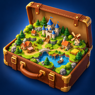

<h1 align="center">Bavul Kasabası · Suitcase Town</h1>

  <b>Bavulunda bir kasaba büyüt, kahramanlarını topla, Odo'nun kayıp bavullarını kurtar.</b> 
  <i>Grow a town inside your suitcase, gather heroes and rescue Odo's lost suitcases.</i>

  
  

  
  
  
  
  

  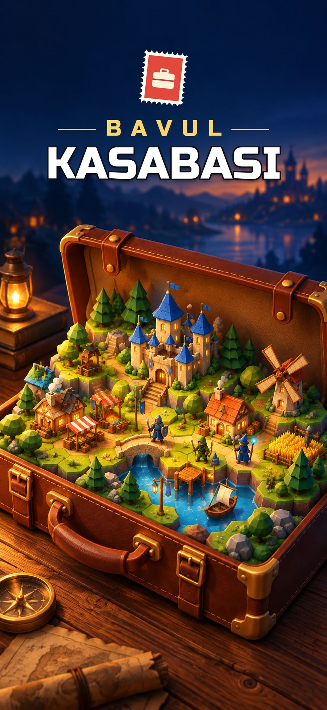&nbsp;
  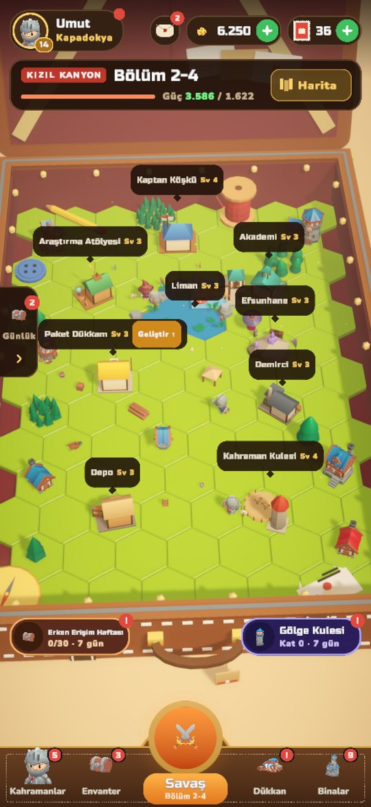&nbsp;
  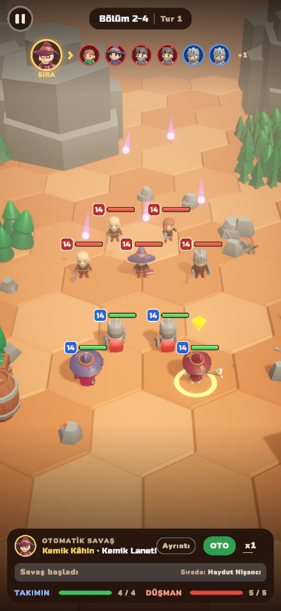

---

## 🧳 Hikâye

Gezgin mucit **Odo**, tehlikedeki diyarları küçültüp bavullarında saklardı. Ta ki **Gölge İmparatoru** bavulları dört bir yana savurana dek. Şimdi elinde tek bir eski deri bavul var… ve yanında sen.

<table align="center">
  <tr>
    <td align="center" colspan="6"><b>1. Sezon · Gölge İmparatoru</b> &nbsp;·&nbsp; Bölüm 1–60</td>
  </tr>
  <tr>
    <td align="center">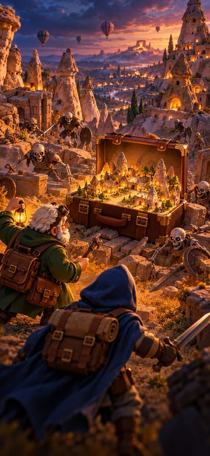 Peri Bacaları</td>
    <td align="center">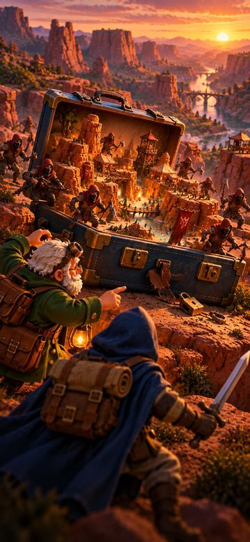 Kızıl Kanyon</td>
    <td align="center">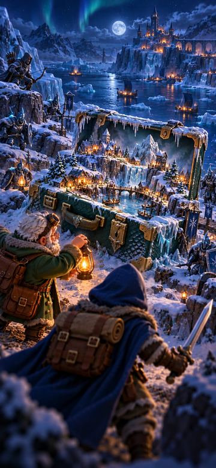 Buzul Fiyortları</td>
    <td align="center">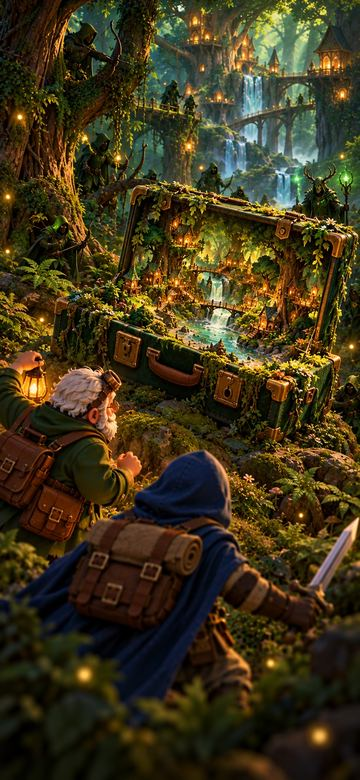 Zümrüt Ormanı</td>
    <td align="center">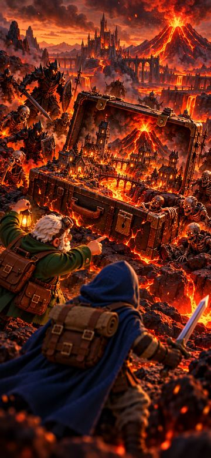 Kül Volkanı</td>
    <td align="center">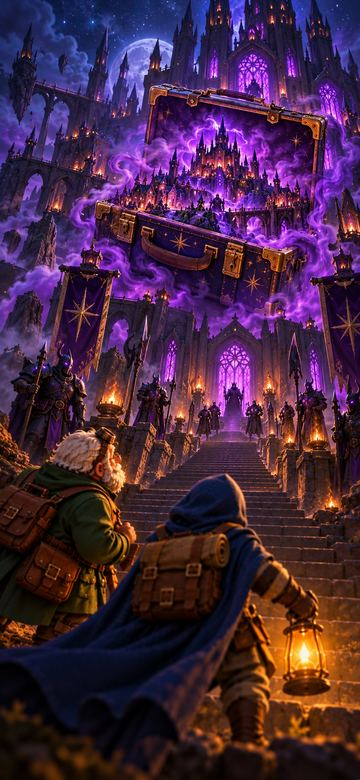 Gölge Sarayı</td>
  </tr>
  <tr>
    <td align="center" colspan="6"><b>2. Sezon · Karanlık Bavullar</b> &nbsp;·&nbsp; Bölüm 61–120 &nbsp;·&nbsp; <i>sürüm 1.0</i></td>
  </tr>
  <tr>
    <td align="center"> Gök Adaları</td>
    <td align="center">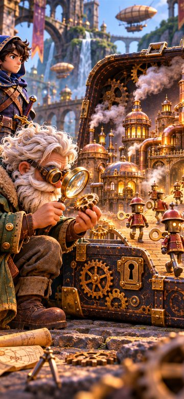 Çark Şehri</td>
    <td align="center">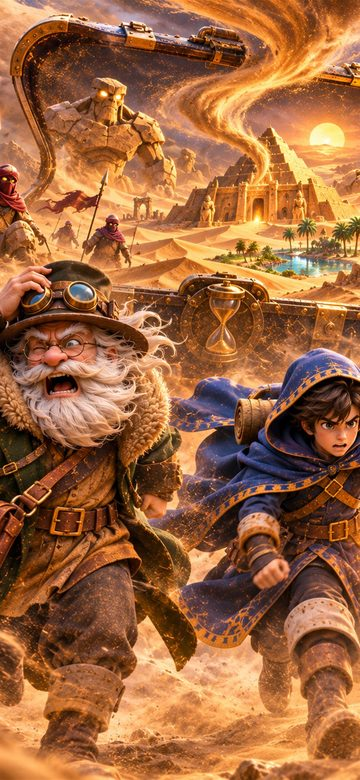 Altın Çöl</td>
    <td align="center">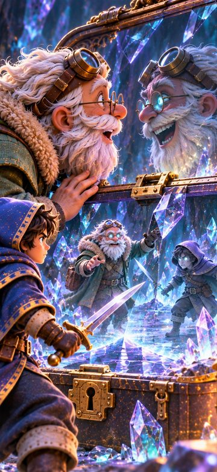 Ayna Mağaraları</td>
    <td align="center"> Batık Şehir</td>
    <td align="center"> Karanlık Atölye</td>
  </tr>
</table>

## ✨ Oyunda neler var?

| | |
|---|---|
| 🏘️ **Kasabanı kur** | Kaptan Köşkü, Demirci, Akademi, Efsunhane, Liman… Her bina yeni bir özellik ve kalıcı bir takım bonusu açar. |
| 🛡️ **Kahramanlarını topla** | Normal'den Efsanevi'ye altı nadirlik; imza yetenekleri 5 yıldızda uyanır. |
| ⚔️ **Taktikle savaş** | Diziliş, sınıf üstünlüğü, doğru hedef. Her bavulun kendi kuralı, her boss'un kendi hilesi var. |
| 🔮 **Efsun ve takım kimyası** | Eşyalarına Güneş, Gece, Fırtına ya da Doğa efsunu bas; aynı efsunu taşıyan takım birlikte güçlenir. |
| 🏰 **Gölge Kulesi** | Her hafta sıfırlanan 50 katlı kule ve Game Center sıralamaları. |
| 🎉 **Etkinlikler** | Yalnızca etkinlikte kazanılan kahramanlar, haftalık boss tekrarları. |

  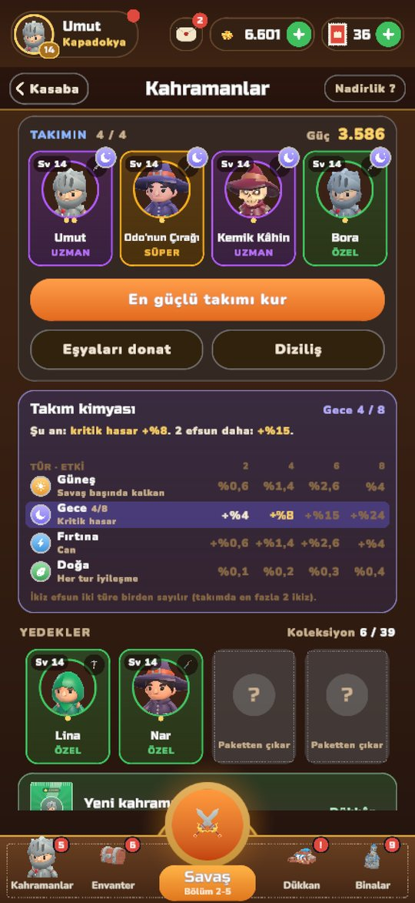&nbsp;
  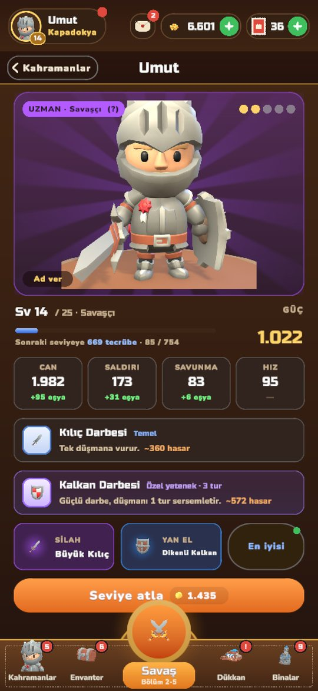&nbsp;
  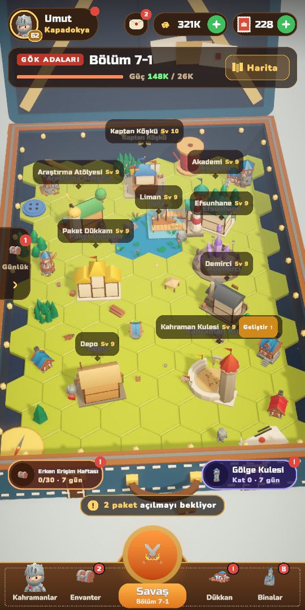

<b>🇬🇧 English</b>

 

A wandering inventor named **Odo** shrank lands in danger and kept them safe in his suitcases, until the **Shadow Emperor** scattered them far and wide. Now he has just one old leather suitcase… and you.

**Suitcase Town** is a free fantasy strategy game for iPhone:

- 🏘️ **Build your town:** every building unlocks a feature and a permanent team bonus.
- 🛡️ **Collect heroes:** six rarities from Common to Mythic, signature skills that awaken at 5 stars.
- ⚔️ **Fight with tactics:** formation, class advantage and bosses with their own tricks.
- 🧳 **Rescue 12 suitcases:** Season 1 *The Shadow Emperor* (stages 1–60) and Season 2 *The Dark Suitcases* (stages 61–120, version 1.0).
- 🏰 **Shadow Tower, events and Game Center leaderboards.**

No ads. Turkish and English.

  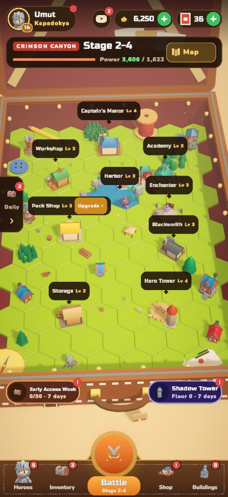&nbsp;
  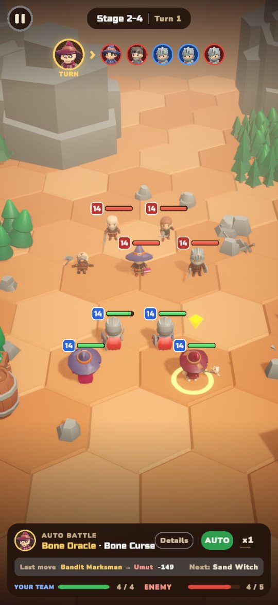&nbsp;
  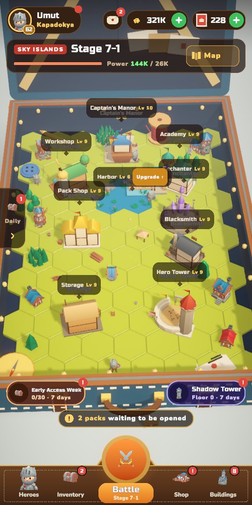

## 🔗 Bağlantılar / Links

| | |
|---|---|
| 📱 App Store | [Bavul Kasabası](https://apps.apple.com/app/id6826223358) |
| 🌐 Web sitesi / Website | [Türkçe](https://umutdurna.github.io/bavul-kasabasi-site/) · [English](https://umutdurna.github.io/bavul-kasabasi-site/en.html) |
| 📰 Güncellemeler / Updates | [Türkçe](https://umutdurna.github.io/bavul-kasabasi-site/guncellemeler.html) · [English](https://umutdurna.github.io/bavul-kasabasi-site/updates.html) |
| 🔒 Gizlilik / Privacy | [Türkçe](https://umutdurna.github.io/bavul-kasabasi-site/gizlilik.html) · [English](https://umutdurna.github.io/bavul-kasabasi-site/privacy.html) |
| ✉️ İletişim / Contact | [bavulkasabasi@gmail.com](mailto:bavulkasabasi@gmail.com) |

---

© 2026 Umut Recep Durna · Bu depo yalnızca oyunun tanıtım sitesini içerir. · This repository contains only the game's website.

