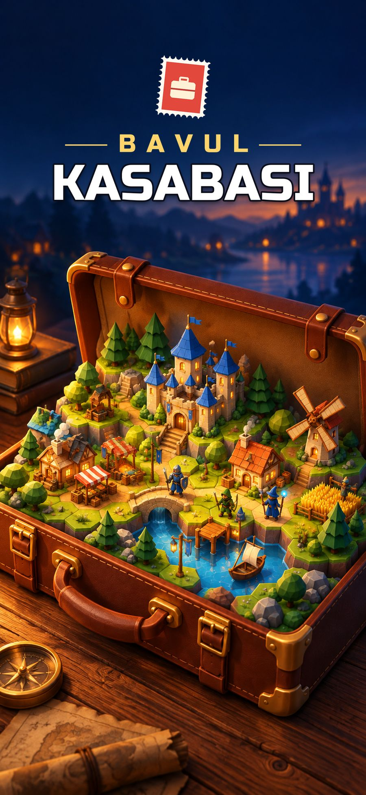

  

<h1 align="center">Bavul Kasabası</h1>

  <b>Bavulunda bir kasaba büyüt.</b> · <i>Grow a town inside your suitcase.</i> 
  <a href="https://umutdurna.github.io/bavul-kasabasi-site/"><b>🌐 Web sitesi / Website</b></a>

  

## 🇹🇷 Oyun hakkında

Gezgin mucit **Odo**, tehlikedeki diyarları küçültüp bavullarında saklardı. Ta ki **Gölge İmparatoru** bavulları dört bir yana savurana dek. Şimdi elinde tek bir eski deri bavul var… ve yanında sen.

**Bavul Kasabası**, iPhone için ücretsiz bir fantastik strateji oyunu:

- 🏘️ **Kasabanı kur:** binalarını geliştir, her biri yeni bir özellik ve kalıcı bir güç açsın.
- 🛡️ **Kahramanlarını topla:** Normal'den Süper'e beş nadirlik, kahramanlara özgü imza yetenekleri.
- ⚔️ **Taktikle savaş:** diziliş, sınıf üstünlüğü ve sürprizlerle dolu sıra tabanlı savaşlar.
- 🗺️ **Bavulları kurtar:** her biri kendi ordusu ve boss'uyla altı bölge.
- 🏰 **Gölge Kulesi** ve **haftalık etkinlikler** ile uzun soluklu bir macera.

Reklam yok, uygulama içi satın alma yok. Oyun **erken erişimde**; düzenli olarak yeni içerik geliyor.

## 🇬🇧 About the game

A wandering inventor named **Odo** shrank lands in danger and kept them safe in his suitcases. Until the **Shadow Emperor** scattered them far and wide. Now he has just one old leather suitcase… and you.

**Bavul Kasabası** is a free fantasy strategy game for iPhone: build your town, collect heroes with signature skills, win turn-based tactical battles and rescue six suitcase worlds. Climb the weekly **Shadow Tower** and join **events**. No ads, no in-app purchases. Currently in **early access**.

## Bağlantılar / Links

| | |
|---|---|
| 🌐 Web sitesi | [umutdurna.github.io/bavul-kasabasi-site](https://umutdurna.github.io/bavul-kasabasi-site/) |
| 📰 Güncellemeler / Updates | [Türkçe](https://umutdurna.github.io/bavul-kasabasi-site/guncellemeler.html) · [English](https://umutdurna.github.io/bavul-kasabasi-site/updates.html) |
| 🔒 Gizlilik / Privacy | [Türkçe](https://umutdurna.github.io/bavul-kasabasi-site/gizlilik.html) · [English](https://umutdurna.github.io/bavul-kasabasi-site/privacy.html) |
| ✉️ İletişim / Contact | [bavulkasabasi@gmail.com](mailto:bavulkasabasi@gmail.com) |

---

© 2026 Umut Recep Durna. Bu depo yalnızca oyunun tanıtım sitesini içerir. · This repository contains only the game's website.

